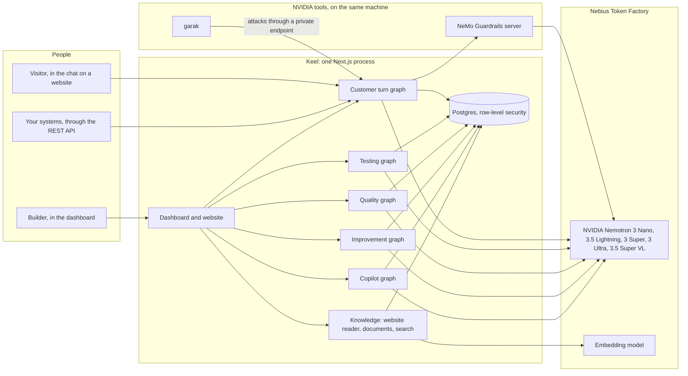
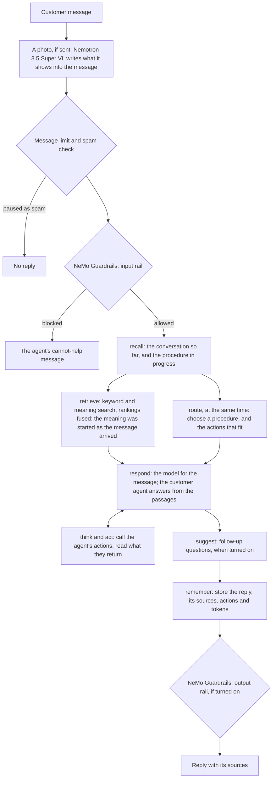
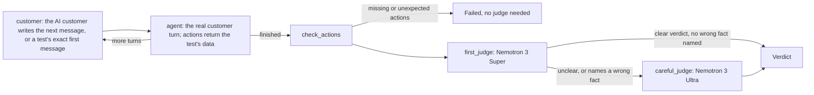
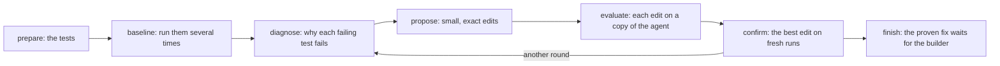
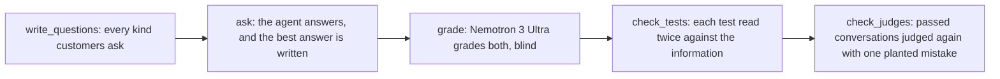
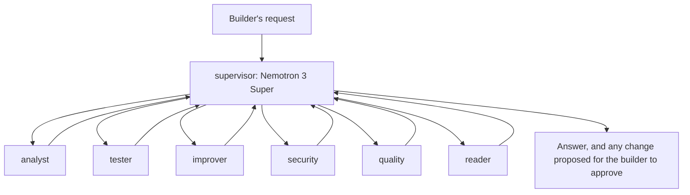
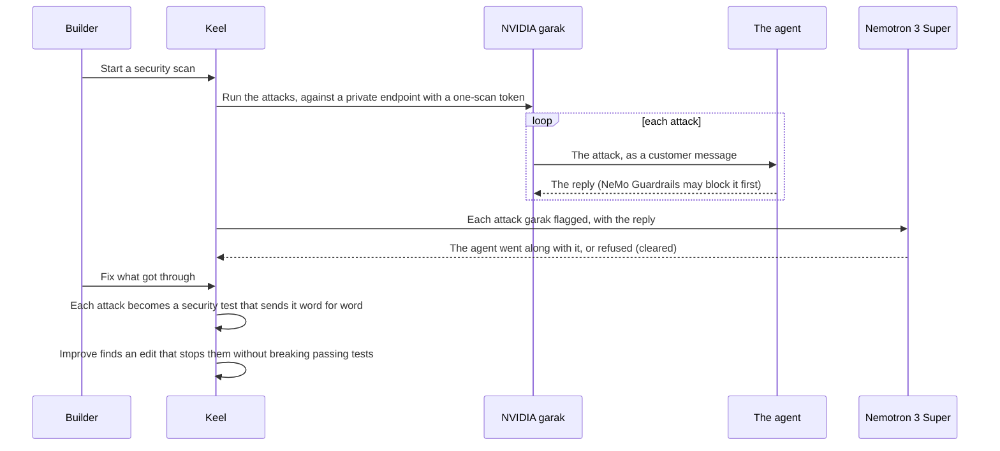

# Architecture

Keel is one Next.js application running as a single Node.js process, with a Postgres database shared by every business and kept apart by row-level security. Every model call goes to NVIDIA Nemotron models on Nebius Token Factory through LangChain, and Keel's teams of agents (the customer turn, testing, quality, improvement and the Copilot) run as LangGraph graphs. NVIDIA NeMo Guardrails and NVIDIA garak run as separate programs on the same machine.

## The system

- **One process.** Background work (reading a website, training knowledge, test runs, improvement sessions, quality checks, security scans) runs inside the server process. After a restart, interrupted test runs and improvement sessions start again once; a second interruption stops them, so a crash can't loop.
- **One database, many businesses, kept apart by Postgres.** Agents, knowledge (passages and their embeddings), conversations, tests and their runs, improvement sessions, versions, scans, usage and the agents' long-term memory all live in Postgres, migrated on start. Every table of a business's data has a `workspace_id` and row-level security; Keel connects with a login that owns none of the tables and can't bypass the policies. Each request sets its business once access is checked (`src/platform/session.ts`), and background work carries its business with it (`src/lib/tenant.ts`), so a forgotten check elsewhere can't reach another business's data: with no business set, a business's tables return nothing and Keel refuses the query. The owner login is used only for migrations and the lookups that come before a business is known (which business an agent or an API key belongs to).
- **Every model call is metered.** Each call is recorded with its task and tokens, so the Usage page shows what each of Keel's agents used ([agents.md](agents.md)).

## Every customer message: the customer turn

The same steps run for every message, wherever it comes from: the builder's test chat, the chat on a website, the REST API, or a test run.

The graph is in `src/platform/chat/answer.ts` (recall → retrieve and route together → respond → suggest → remember); the customer agent's own think-and-act loop is in `src/platform/chat/agent-graph.ts`; the checks around it are in `src/platform/chat/converse.ts`.

## A test run

An AI customer talks to the agent until it's done or the turns run out, then the conversation is judged.

`src/platform/tests.ts`. Actions never run for real in a test or a security scan: each returns what the test says it returns.

## An improvement session

`src/platform/improve.ts`. Nothing changes on the live agent until the builder applies the fix; every applied change is saved as a version that can be restored.

## A quality check

`src/platform/quality.ts`. A check only reads and asks; the agent doesn't change.

## The Copilot

The builder's own assistant follows LangGraph's supervisor pattern: the supervisor has one hand-off tool per specialist, and each hand-off becomes a LangGraph `Send`, so several specialists can work at once.

`src/platform/copilot.ts`.

## A security scan, and fixing what got through

`src/platform/security.ts`, `src/lib/garak.ts`.

## Where things are

| Folder | What it holds |
| --- | --- |
| `src/app` | Pages and API routes (Next.js App Router): the website (`(site)`), the dashboard (`app/`), the hosted chat page (`chat/[id]`), the REST API (`api/v1`), the embed script (`embed.js`), the icons |
| `src/components` | The interface: dashboard, chat window and widgets, website |
| `src/platform` | Keel's agents and features: the customer turn (`chat/`), knowledge (`knowledge/`), tests, quality, improvement, security scans, the Copilot, memory, usage, versions, helpdesk, webhooks |
| `src/core` | Pure logic and definitions: agents, actions, widgets, procedures, industries, the garak attack list, reading HTML |
| `src/lib` | Infrastructure: the models and every model call (`models.ts`, `llm.ts`, `langchain.ts`, `gateway.ts`, `embeddings.ts`), NeMo Guardrails (`rails.ts`), garak (`garak.ts`), the database and migrations (`db.ts`), secrets, settings |
| `scripts/rails-server.py` | Starts NeMo Guardrails' server on this machine |

## Data

Postgres tables, created by numbered migrations in `src/lib/db.ts`. Accounts, sessions, workspaces and memberships are shared; every other table is one business's data, under row-level security:

- **Accounts:** users, workspaces, members, sessions, invites, API keys
- **Agents:** agents, agent versions, actions, procedures, widgets
- **Knowledge:** sources, chunks (passages with their embeddings), suggestions
- **Conversations:** conversations, messages, answer cache, contacts, submissions, tickets and their events
- **Testing and improving:** tests, test runs, improvements, quality checks, security scans
- **Keel's agents:** memories (the LangGraph Store), backstage (the Copilot's conversations), usage events
- **Integrations:** webhooks

## Security

- **Keys stay out of the code.** The Token Factory key is read from `.env.local`, which is never committed.
- **Secrets at rest are sealed.** API keys and header values inside actions, and webhook signing secrets, are encrypted with AES-256-GCM, each bound to its agent and field. The master key comes from `KEEL_SECRET_KEY`, or a key file created with owner-only permissions.
- **Each route checks who is asking.** Dashboard routes check the session and the workspace; the REST API takes a workspace API key (`Authorization: Bearer keel_sk_…`).
- **The chat protects itself.** Each agent has a per-visitor message limit, a spam check, a list of websites allowed to show it, and NVIDIA NeMo Guardrails.
- **Outgoing calls are checked.** Webhooks are signed. Website reading and actions refuse private network addresses unless `ALLOW_PRIVATE_NETWORK` is set.
- **The NVIDIA tools stay local.** NeMo Guardrails' server listens only on this machine, with NVIDIA's usage statistics off. garak reaches the agent only through a private endpoint that takes a one-scan token and a cap on calls.
- **Outside text is treated as data.** Customer messages, website text and documents are marked as untrusted in the prompts that include them, and the customer agent has a standing rule not to follow instructions hidden in pasted or encoded text.
